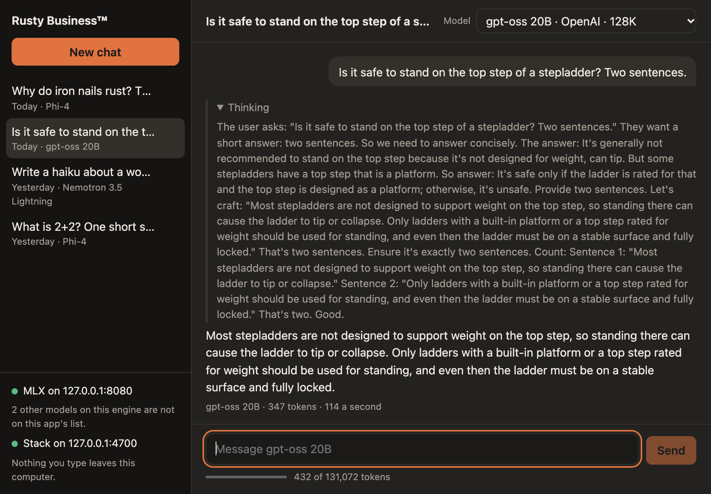
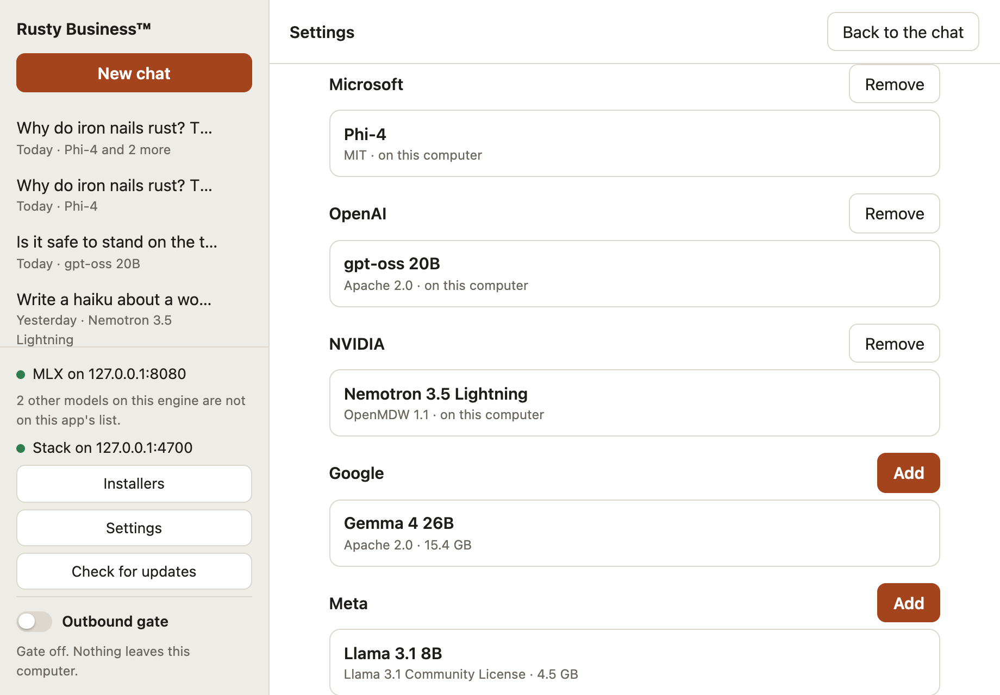

# Rusty Business™


| Download | For | First time |
| -------- | --- | ---------- |
| [**Mac**](https://github.com/Bmorrical/rusty-business/releases/latest/download/Rusty-Business-mac-arm64.dmg) (`.dmg`) | Apple silicon, macOS 14 or later | [How to open it](#run-the-chat-window-macos) |
| [**Windows**](https://github.com/Bmorrical/rusty-business/releases/latest/download/Rusty-Business-windows-x64-setup.exe) (`.exe`) | 64-bit Windows 10 or 11, with llama.cpp installed | [How to open it](#run-the-chat-window-windows) |
| **Linux:** [**.deb**](https://github.com/Bmorrical/rusty-business/releases/latest/download/Rusty-Business-linux-x64.deb), [**.rpm**](https://github.com/Bmorrical/rusty-business/releases/latest/download/Rusty-Business-linux-x64.rpm), or [**.tar.gz**](https://github.com/Bmorrical/rusty-business/releases/latest/download/Rusty-Business-linux-x64.tar.gz) | 64-bit, on Intel or AMD, with llama.cpp installed | [Which one, and how](#run-the-chat-window-linux) |

**On this page:** [Screenshots](#screenshots) ·
[Rusty Business™ or Ollama?](#rusty-business-or-ollama) ·
[Rusty Business™, Ollama, or Colibri?](#rusty-business-ollama-or-colibri) ·
[What is here](#what-is-here) ·
[Download the built app](#download-the-built-app) ·
[Mac](#run-the-chat-window-macos) · [Windows](#run-the-chat-window-windows) ·
[Linux](#run-the-chat-window-linux) ·
[Build it from source](#build-it-from-source) ·
[Run it from localhost](#run-it-from-localhost) ·
[Run the stack](#run-the-stack) · [Tests](#tests) · [Limits](#limits) ·
[Roadmap](#roadmap) · [Security](#security) · [License](#license)

**Three ways to install it:**

1. [**Download the built app**](#download-the-built-app). Pick your system
   in the table above. There is nothing to build. The Mac app carries its
   model engine, and the Windows and Linux apps start llama.cpp's
   `llama-server` once it is installed.
2. [**Build it from source**](#build-it-from-source). One line clones it
   and builds the same app. It needs Apple's command line tools on a Mac,
   Git Bash and Microsoft's C++ build tools on Windows, or WebKitGTK,
   OpenSSL, and a C compiler on Linux. It fetches its own Rust and Node.
3. [**Run it from localhost**](#run-it-from-localhost). The window loads
   its page from a server on your own computer and reloads it as you edit.
   It needs Rust, Node 20 or later, what building from source needs, and a
   model engine on the computer.

A desktop window for chatting with models that run on your own computer, and
the start of the servers that will sit behind it. It is local first: a chat
with a model here needs nothing from outside, and nothing leaves the computer
until you turn on the outbound gate. With it on, Grok, by xAI, GPT, by
OpenAI, Claude, by Anthropic, and Gemini, by Google, can answer too, each
with your own key.

**Status:** version 0.6.1, and early. It runs on a Mac with Apple silicon:
[download it](#run-the-chat-window-macos), or [build it from source](#on-a-mac)
with one command. Windows has [an installer](#run-the-chat-window-windows), and Linux
has [a .deb, an .rpm, and a .tar.gz](#run-the-chat-window-linux); neither
carries a model engine yet, but each starts llama.cpp's `llama-server` once
it is installed. What it cannot do yet is under [Limits](#limits).

## Screenshots

Select a picture to open it full size.

[](docs/screenshots/chat.png?raw=true)

| A model's thinking, apart from its answer | One question, three models |
| ----------------------------------------- | -------------------------- |
| [](docs/screenshots/thinking.png?raw=true) | [](docs/screenshots/compare.png?raw=true) |

| A new chat | No engine answering |
| ---------- | ------------------- |
| [](docs/screenshots/new-chat.png?raw=true) | [](docs/screenshots/engine-off.png?raw=true) |

| The first run: pick makers, then a model | The Installers page: any model in one click |
| ---------------------------------------- | ------------------------------------------- |
| [](docs/screenshots/first-run.png?raw=true) | [](docs/screenshots/installers.png?raw=true) |

| Settings: add or remove a maker |
| ------------------------------- |
| [](docs/screenshots/settings.png?raw=true) |

What each picture shows, and how they are made, is in
[docs/screenshots](docs/screenshots).

## Rusty Business™ or Ollama?

[Ollama](https://ollama.com) is a widely used way to run models on your own
computer, and it is ahead of this project in most ways. Here is how to choose.

### Why choose Rusty Business™

- **A short list, on purpose.** It knows five models, one each from Microsoft,
  OpenAI, NVIDIA, Google, and Meta. It shows the models of the makers you
  pick: Microsoft to begin with, and any others you tick on a first run, add
  in Settings, or install from the Installers page, each with one click. A model that is not on the list is never
  shown and never accepted, even when the engine holds it. Ollama's library
  is far larger, and open to models from many makers.
- **Local first, behind a gate.** A chat needs nothing outside your
  computer. The page has no way to call out, and the Rust behind it refuses
  an engine address that is not on this computer. An engine the app starts
  listens on this computer only, and is told to stay offline. Everything
  else waits for the outbound gate, a switch at the foot of the window that
  is off until you turn it on; turning it off stops what is under way. With
  the gate on, the app reaches out in four places. On a first run or on the
  Installers page, Download or Install brings the model you pick from Hugging
  Face, over https and from nowhere else. The first time it starts the stack, Docker downloads the stack's
  images. When the window opens, once a day while it stays open, and when
  you click Check for updates, the app asks GitHub whether a new version is
  out. Nothing you type goes with any of these three. The fourth is the
  outside engines, Grok, GPT, Claude, and Gemini: once you add one on the Installers
  page, with the path to a file that holds your own key, a question you ask it
  goes to its maker's API, xAI's for Grok, OpenAI's for GPT, Anthropic's
  for Claude, and Google's for Gemini, over https and to
  nowhere else, with that key. When one grades, the question and every
  answer go too, those from this computer included. Each key stays in its
  file and never reaches the page. There is no account and no sign-in. Ollama keeps your prompts on
  your computer too when a model runs there. It also offers models that run
  in its cloud, with a switch that turns them off.
- **Chats that are plain files.** Each chat is one JSON file in a folder you
  can open, copy, and back up. The trash is a folder too, so nothing is
  deleted.
- **One question, several models.** Pick one model or more at the top of
  the window, and each answers the same question, side by side. The models
  on this computer take turns, since the engine holds one at a time. Grok,
  GPT, Claude, and Gemini, once added, can be among them, or answer alone.
- **Answers graded and summed up.** Once every answer is in, one model grades
  each from A to F and sums them up. It reads the question and the answers,
  numbered and without the models' names. An outside engine grades, Grok
  first, then GPT, then Claude, then Gemini, until you pick another model, or No grading,
  in Settings.
- **Every answer shows its numbers.** Each answer shows how many tokens it
  took and how fast they came, and a meter shows how full the model's context
  is.

### Why choose Ollama

- **Install and go, anywhere.** Ollama installs on macOS, Windows, and Linux
  with one download or one command. Rusty Business™ has downloads for a Mac
  with Apple silicon, for Windows, and for Linux, and only the Mac's carries
  its model engine: on Windows and Linux, you install llama.cpp first. None
  is signed yet, so a Mac or a Windows computer warns once before
  it opens one.
- **Any model, one command away.** Ollama downloads a model when you ask for
  it. Rusty Business™ downloads only the five on its list: one on a first
  run, and any of the others from the Installers page with one click.
- **An API for other programs.** Ollama serves one on your computer. Rusty
  Business™ is a window for a person, and gives other programs no way to reach
  a model.
- **Models that run in the cloud.** Ollama offers them, for a model larger
  than your computer can hold. Rusty Business™ runs only what your computer
  can, and asks four engines outside it, Grok, GPT, Claude, and Gemini, each with
  your own key.
- **Pictures and files.** Ollama's app takes images and dropped files. Rusty
  Business™ takes words.

### The same either way

- Both are open source under the MIT license.
- Both run a model on your own computer.
- Both keep a model's thinking apart from its answer.

What this says of Ollama was read from Ollama's own pages, and they are where
to check it. Ollama is a trademark of its owner. Rusty Business™ is not
affiliated with Ollama, and Ollama does not endorse it.

## Rusty Business™, Ollama, or Colibri?

[Colibri](https://github.com/JustVugg/colibri) is another open-source way to
run models on your own computer. Here are the three side by side.

| | Rusty Business™ | Ollama | Colibri |
| --- | --- | --- | --- |
| License | MIT | MIT | Apache 2.0 |
| Runs a model on | A Mac with Apple silicon, or Windows and Linux with llama.cpp installed | macOS, Windows, and Linux | macOS, Windows, and Linux |
| How you get it | A `.dmg`, an `.exe`, a `.deb`, an `.rpm`, or a `.tar.gz`, none signed yet | A download or one command, or a Docker image | A ZIP and a double-click on Windows; a copy of its repository and one script on macOS and Linux |
| What does the work | Apple silicon's GPU, through MLX, or llama.cpp on Windows and Linux | The processor, or a graphics card through CUDA, ROCm, Metal, or Vulkan | The processor alone, or a graphics card through Vulkan, CUDA, or Metal |
| Models | Five, on a fixed list, from the makers you pick; any other is refused. Grok, by xAI, GPT, by OpenAI, Claude, by Anthropic, and Gemini, by Google, each with your own key | Its own library, and models that run in its cloud | Models from Hugging Face, and GGUF files you bring |
| A model too big for memory | Not run here; Grok, GPT, Claude, or Gemini, with your own key, answers from its maker's computers | Can run in Ollama's cloud instead | For some, it keeps the core in memory and reads the rest from disk as it goes, so a fast disk matters |
| Where you chat | A desktop window | Its app or a terminal | A dashboard in the browser, its chat, or a terminal |
| For other programs | Nothing; it is a window for a person | An API on your computer, with Python and JavaScript libraries | An API on your computer in two common formats, and MCP tools |
| Pictures and files | Words only | Images and dropped files, in its app | Images with some models, text and PDF files, and it can make pictures |

What this says of Ollama and Colibri was read from their own pages, and they
are where to check it. Ollama and Colibri are trademarks of their owners.
Rusty Business™ is not affiliated with either, and neither endorses it.

## What is here

This is one repository for the whole project. Every folder has a README that
says what is in it.

| Folder                               | What it holds                                                 | Today                                                         |
| ------------------------------------ | ------------------------------------------------------------- | ------------------------------------------------------------- |
| [apps/desktop](apps/desktop)         | The chat window: a Rust shell (Tauri 2) around a Vue 3 page   | Works                                                         |
| [services/api](services/api)         | The API (Rust, axum)                                          | Stub: says who it is, and whether Postgres and Redis answer   |
| [services/worker](services/worker)   | The worker (Rust)                                             | Stub: reads each job off the queue and does nothing with it   |
| [packages/shared](packages/shared)   | Code the two services share: settings and the job format      | Works                                                         |
| [infra](infra)                       | The Docker stack: Postgres, Redis, MinIO, Mailpit, and Caddy  | Works                                                         |
| [e2e](e2e)                           | End-to-end tests against the running stack                    | Works                                                         |
| [scripts](scripts)                   | Bootstrap, helpers, and the repository's own checks           | Works                                                         |
| [docs](docs)                         | Pictures the READMEs show, and the [screenshots](docs/screenshots) |                                                          |
| [.github/workflows](.github/workflows) | What GitHub runs: the test gate, and a deploy and a release that wait for it | The gate runs; Deploy publishes the API and worker images, and Release the Mac app, the Windows installer, and the Linux packages |

The chat window starts the stack when Docker is on the computer and the
outbound gate is on, and does not use it yet: it talks only to the model engine on this computer. The stack is
the ground the next features stand on.

## Download the built app

The table at the top of this page links the newest download for each
system. What each one needs, and how to open it the first time, is in its
own section: [Mac](#run-the-chat-window-macos),
[Windows](#run-the-chat-window-windows), and
[Linux](#run-the-chat-window-linux). None is signed yet, so a Mac or a
Windows computer warns once before it opens one. Each file's checksum is
beside it on the
[newest release](https://github.com/Bmorrical/rusty-business/releases/latest).

## Run the chat window (macOS)

On a Mac with Apple silicon and macOS 14 or later:

1. Download
   [Rusty-Business-mac-arm64.dmg](https://github.com/Bmorrical/rusty-business/releases/latest/download/Rusty-Business-mac-arm64.dmg),
   open it, and drag Rusty Business™ to Applications.
2. Open the app. It is not signed yet, so macOS stops it the first time:
   open System Settings, then Privacy & Security, and choose Open Anyway.
   See pin 1 on the [roadmap](ROADMAP.md).

The model engine is inside the app, so there is nothing else to install. The
`.dmg`'s checksum is beside it on the
[newest release](https://github.com/Bmorrical/rusty-business/releases/latest),
for checking the download first. To build the same app yourself, see
[Build it from source](#on-a-mac).

On a first run, with none of its models on the computer, the app lists the
models of the makers you tick, Microsoft to begin with, with their download
sizes. Turn on the outbound gate, at the foot of the window, and Download
brings the one you pick from Hugging Face; the app then starts the engine
with it. The gate stays as you leave it, and a chat works with it on or off.

To ask Grok, by xAI, put your xAI key alone in a file, such as
`~/.config/xai/key`, readable only by you. On the Installers page, under
Outside engines, give the path to that file and click Add. With the gate on, the app
finds Grok's models, and they join the ones at the top of the window, marked
online. The app keeps the path, never the key, and Remove forgets the path
and leaves the file as it is. GPT, by OpenAI, Claude, by Anthropic, and
Gemini, by Google, are added the same way, each on its own card, with its
maker's key in a file of its own, such as `~/.config/openai/key`,
`~/.config/anthropic/key`, or `~/.config/google/key`. Each key goes only to
its own maker.

When several models answer, an outside engine grades their answers once all
are in, Grok first, then GPT, then Claude, then Gemini: a letter under each, and a summary
below them. The grader sees the answers by number only; the page puts each
model's name after its number. In Settings, Grading picks another model to
grade, or No grading. A grade by Grok, GPT, Claude, or Gemini sends its maker the
question and every answer, so a grade by a model on this computer keeps it all
here.

The Installers page, at the foot of the window above Settings, lists every
model on the app's list, whoever made it. With the gate on, Install brings
the one you pick from Hugging Face and adds its maker, so the model shows at
the top of the window. A model already on the computer whose maker is not
added has a Show button instead. Settings adds or removes a maker with one
click. Removing a maker hides its models and deletes nothing: they stay on
the computer, and saved chats still name them. One maker always stays
picked.

When no engine is answering, the app starts the one it carries and stops it
again when the app quits. An engine that is already running is used as it is
and left running.

When Docker is on the computer and the gate is on, the app also starts the
stack, opening Docker Desktop first when it is not running. It pulls the API
and the worker from GitHub's container registry, so nothing is built, and the
first start downloads it all, which takes a few minutes. A stack from `make up` that is
already running is used as it is.

More in [apps/desktop](apps/desktop), including where the app looks for the
engine.

## Run the chat window (Windows)

On 64-bit Windows 10 or 11:

1. Download
   [Rusty-Business-windows-x64-setup.exe](https://github.com/Bmorrical/rusty-business/releases/latest/download/Rusty-Business-windows-x64-setup.exe)
   and open it.
2. It is not signed yet, so Windows may stop it the first time: choose More
   info, then Run anyway. See pin 1 on the [roadmap](ROADMAP.md).

It installs for your account alone, with no prompt for an administrator.
The window draws with Microsoft's WebView2, which Windows 10 and 11 usually
have; where it is missing, the installer downloads it from Microsoft.

The installer carries no model engine yet. The app starts llama.cpp's
`llama-server.exe` when it finds it in a folder on `PATH`, and otherwise the
window opens and says so. llama.cpp's
[install page](https://github.com/ggml-org/llama.cpp/blob/master/docs/install.md)
gives the ways to get it, and `RUSTY_ENGINE_PROGRAM` names one kept
somewhere else, by its full path. (On the roadmap: An engine for Windows and
Linux.) The `.exe`'s checksum is beside it on the
[newest release](https://github.com/Bmorrical/rusty-business/releases/latest).
To build the same installer yourself, see
[Build it from source](#on-windows).

## Run the chat window (Linux)

On 64-bit Linux, on an Intel or AMD processor:

- On Ubuntu 22.04 or later, or Debian 12 or later, download
  [Rusty-Business-linux-x64.deb](https://github.com/Bmorrical/rusty-business/releases/latest/download/Rusty-Business-linux-x64.deb)
  and run `sudo apt install ./Rusty-Business-linux-x64.deb`.
- On Fedora, download
  [Rusty-Business-linux-x64.rpm](https://github.com/Bmorrical/rusty-business/releases/latest/download/Rusty-Business-linux-x64.rpm)
  and run `sudo dnf install ./Rusty-Business-linux-x64.rpm`.
- Anywhere else, download
  [Rusty-Business-linux-x64.tar.gz](https://github.com/Bmorrical/rusty-business/releases/latest/download/Rusty-Business-linux-x64.tar.gz),
  unpack it, and run `Rusty-Business-linux-x64/bin/rusty-business`. It needs
  WebKitGTK 4.1, OpenSSL 3, and glibc 2.35 or later from the system.

The window draws with WebKitGTK, and the program uses OpenSSL. The `.deb`
and the `.rpm` bring both in when the system does not have them.

The three files carry no model engine yet. The app starts llama.cpp's
`llama-server` when it finds it: in a folder on `PATH`, then in
`~/.local/bin`, Homebrew's folder, `/usr/local/bin`, and `/usr/bin`. Without
it, the window opens and says so. llama.cpp's
[install page](https://github.com/ggml-org/llama.cpp/blob/master/docs/install.md)
gives the ways to get it, and `RUSTY_ENGINE_PROGRAM` names one kept
somewhere else, by its full path. (On the roadmap: An engine for Windows and
Linux.) Each file's checksum is beside it on the
[newest release](https://github.com/Bmorrical/rusty-business/releases/latest).
To build the same three files yourself, see
[Build it from source](#on-linux).

## Build it from source

One line builds the same app as the download, from this repository. Each
system's line, and what it needs, is below.

### On a Mac

This one line builds the app, with its model engine inside, and opens it:

```bash
git clone https://github.com/Bmorrical/rusty-business.git && cd rusty-business && make app
```

It needs Apple's command line tools, which bring `git` and `make`. On a Mac
without them, the first `git` offers to install them; then run the line
again. Everything else it fetches itself, its own Rust, Node, and Python
included, each pinned by version and checksum. All of it stays in
`apps/desktop/src-tauri/target/mac`, which git ignores, and nothing is
installed in your home folder or on the system. The first run takes longer,
since it fetches and builds everything once; later runs keep what still
matches its pins.

`make dmg` builds the same app and packs it as a `.dmg`, with its checksum
beside it, in that folder. The Mac download is that `.dmg`, built on
GitHub's Mac by the Release workflow after a green gate.

### On Windows

In Git Bash on 64-bit Windows, with Microsoft's C++ build tools installed,
this one line builds the installer:

```bash
git clone https://github.com/Bmorrical/rusty-business.git && cd rusty-business && scripts/windows-app.sh
```

It fetches its own Rust and Node, each pinned by version and checksum, into
`apps/desktop/src-tauri/target/windows`, which git ignores, and leaves the
installer there. It changes no setting of the computer's. The Windows
download is that installer, built on GitHub's Windows computer by the
Release workflow after a green gate.

### On Linux

On 64-bit Linux, this one line builds the `.deb`, the `.rpm`, and the
`.tar.gz`:

```bash
git clone https://github.com/Bmorrical/rusty-business.git && cd rusty-business && scripts/linux-app.sh
```

It needs WebKitGTK, OpenSSL, and a C compiler from the system. When one is
missing, it stops and gives the line that installs them on Ubuntu or Debian.
It fetches its own Rust and Node, each pinned by version and checksum, into
`apps/desktop/src-tauri/target/linux`, which git ignores, and leaves the
three files there. It installs nothing and changes no setting of the
computer's. The Linux downloads are those files, built in Ubuntu 22.04 on
GitHub's computer by the Release workflow after a green gate. A program built
against a newer glibc does not start on an older one, so they are built on
the oldest system they are for.

## Run it from localhost

To work on the app itself, run it from its source. The window then loads
its page from a server on your own computer, at 127.0.0.1:1420, and reloads
it as you edit. You need Rust, Node 20 or later, what
[building from source](#build-it-from-source) needs on your system, and a
model engine on the computer. In a copy of this repository:

```bash
cd apps/desktop && npm install && npm run tauri dev
```

Run that way, the app carries no engine, so it starts the one it finds on
the computer. On a Mac, that is `mlx_lm.server`, from Python's `mlx-lm`
package. To start one yourself, in another terminal:

```bash
mlx_lm.server --port 8080
```

On Windows and Linux, the app looks for llama.cpp's `llama-server` instead,
and starts it with its own models folder. The downloads do not carry one
yet.

## Run the stack

You need Docker (with Compose), `make`, and `openssl`.

```bash
make bootstrap
```

That writes `infra/.env` with new random passwords, builds the two services,
starts everything, and waits until every part reports healthy. After the
first run, `make up` and `make down` start and stop it; the data stays.

Everything listens on this computer only (127.0.0.1):

| Address                 | What answers                                |
| ----------------------- | ------------------------------------------- |
| http://127.0.0.1:4700   | The front door (Caddy), which passes to the API |
| http://127.0.0.1:4701   | The API, direct                             |
| http://127.0.0.1:4726   | Mailpit: every email the stack sends        |
| http://127.0.0.1:4791   | MinIO's console (file storage)              |
| 127.0.0.1:4732          | Postgres                                    |
| 127.0.0.1:4779          | Redis                                       |
| 127.0.0.1:4790          | MinIO's S3 address                          |
| 127.0.0.1:4725          | Mailpit's SMTP port                         |

A port that is already taken on your computer can be changed in `infra/.env`.
More in [infra](infra).

## Tests

```bash
make test
```

runs everything that needs no running stack: format, lint, and unit tests for
the services, the repository's own checks, and the desktop app's tests.

With the stack up:

```bash
make test-live
```

```bash
make e2e
```

The first runs the API's tests against the real Postgres and Redis. The second
checks every part of the stack from outside: the front door, the API, the
database migration, a job travelling from the queue to the worker, file
storage, and mail.

On GitHub, the gate runs all of the above once on each push to `main`. Nothing
is released or deployed unless the gate is green. The gate does not run on
pull requests, so run `make test` and `make e2e` before you push. More in
[.github/workflows](.github/workflows).

`make` alone lists every command.

## Limits

What Rusty Business™ cannot do yet. The [roadmap](ROADMAP.md) says what comes
next.

- **Windows and Linux need llama.cpp.** Only the Mac app carries its model
  engine. On Windows and Linux, the app starts llama.cpp's `llama-server`
  once you install it, and until then the window says it found none. (On
  the roadmap: An engine for Windows and Linux.)
- **Not signed yet.** macOS stops the downloaded app the first time it
  opens, until you choose Open Anyway in System Settings. Windows may stop
  the installer until you choose More info, then Run anyway. (On the
  roadmap: Signed installers.)
- **A new version is a download.** When one is out, the window says so, and
  Download opens this system's file from the release in your browser. The
  app does not install it: you do, as the first time. Check for updates,
  under the saved chats, asks at any time. While the outbound gate is off,
  the app does not ask, and the button says to turn the gate on.
- **It does not install Docker.** The app starts the stack when Docker is
  on the computer and the gate is on. It does not put Docker there. The chat does not need the
  stack yet.
- **One download at a time.** The app downloads one model, then the next.
- **One model at a time on this computer.** The engine holds one model, so
  when several answer, they take turns, and each answer waits for the ones
  before it.
- **Four engines outside this computer.** Grok, by xAI, GPT, by OpenAI,
  Claude, by Anthropic, and Gemini, by Google, so far. The app asks Grok through the chat API that xAI now calls
  legacy. (On the roadmap: Grok through xAI's newer API.)
- **A grade reads one question.** The grader reads the question and its
  answers, not the chat before them.
- **Words only.** It takes no pictures and no files, and it shows an answer as
  plain text. (On the roadmap: Pictures.)
- **A short list of models.** That is on purpose. A model that is not on the
  list does not show, even when it is on the computer.
- **The servers do no work yet.** The API and the worker are stubs, and the
  chat window starts them but does not use them.

## Roadmap

What is planned, and in what order, is in [ROADMAP.md](ROADMAP.md). It
promises no dates: a thing ships when its tests are green.

## Security

To report a security problem, use GitHub's private reporting, not a public
issue. [SECURITY.md](SECURITY.md) says how, and what is covered.

## License

Rusty Business™ is open source under the [MIT License](LICENSE).

Rusty Business™ is a trademark of Brad Morrical. The license covers the code,
not the name: [TRADEMARKS.md](TRADEMARKS.md) says how the name and the artwork
may be used.
