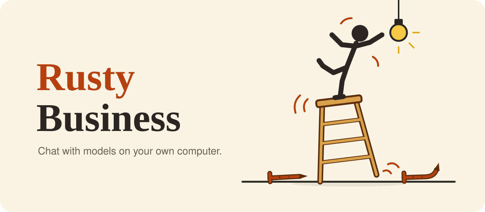
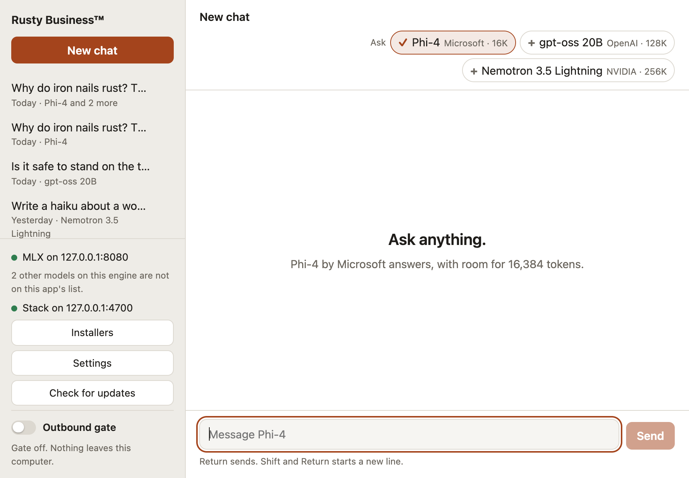
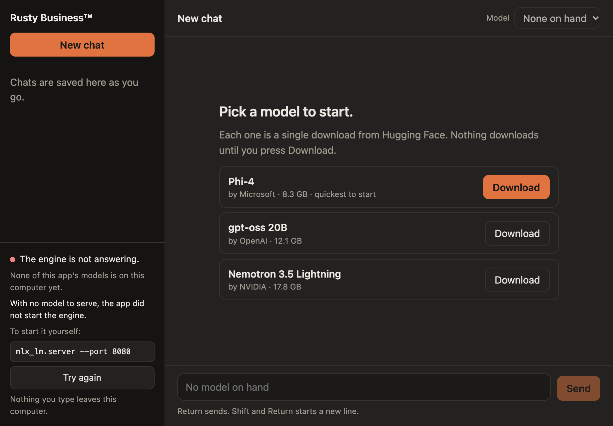

# Rusty Business™



A desktop window for chatting with models that run on your own computer, and
the start of the servers that will sit behind it. Nothing you type leaves the
machine.

**Status:** version 0.1.0, and early. It runs on a Mac with Apple silicon, and
you build it from source. What it cannot do yet is under [Limits](#limits).

## Screenshots

Select a picture to open it full size.

[](docs/screenshots/chat.png?raw=true)

| A model's thinking, apart from its answer | A new chat |
| ----------------------------------------- | ---------- |
| [](docs/screenshots/thinking.png?raw=true) | [](docs/screenshots/new-chat.png?raw=true) |

| No engine answering | The first run: pick a model |
| ------------------- | --------------------------- |
| [](docs/screenshots/engine-off.png?raw=true) | [](docs/screenshots/first-run.png?raw=true) |

What each picture shows, and how they are made, is in
[docs/screenshots](docs/screenshots).

## Rusty Business™ or Ollama?

[Ollama](https://ollama.com) is a widely used way to run models on your own
computer, and it is ahead of this project in most ways. Here is how to choose.

### Why choose Rusty Business™

- **A short list, on purpose.** It knows three models, from Microsoft, OpenAI,
  and NVIDIA. A model that is not on the list is never shown and never
  accepted, even when the engine holds it. Ollama's library is far larger, and
  open to models from many makers.
- **A window that cannot reach past your computer.** That is how it is built,
  not a setting. The page has no way to call out, and the Rust behind it
  refuses an engine address that is not on this computer. An engine the app
  starts listens on this computer only, and is told to stay offline. The app
  itself reaches out once, and only when you ask: on a first run, Download
  brings the model you pick from Hugging Face, over https and from nowhere
  else, and nothing you type goes with it. There is no account, no sign-in,
  and nothing in the cloud. Ollama keeps your prompts on your computer too
  when a model runs there. It also offers models that run in its cloud, with
  a switch that turns them off.
- **Chats that are plain files.** Each chat is one JSON file in a folder you
  can open, copy, and back up. The trash is a folder too, so nothing is
  deleted.
- **Every answer shows its numbers.** Each answer shows how many tokens it
  took and how fast they came, and a meter shows how full the model's context
  is.

### Why choose Ollama

- **Install and go, today.** Ollama installs on macOS, Windows, and Linux with
  one download or one command. Rusty Business™ has no installer yet, and runs
  on a Mac with Apple silicon only.
- **Any model, one command away.** Ollama downloads a model when you ask for
  it. Rusty Business™ downloads one of its three models on a first run, when
  none of them is on the computer yet, and its engine is a separate program
  that you install yourself.
- **An API for other programs.** Ollama serves one on your computer. Rusty
  Business™ is a window for a person, and gives other programs no way to reach
  a model.
- **Models that run in the cloud.** Ollama offers them, for a model larger
  than your computer can hold. Rusty Business™ runs only what your computer
  can.
- **Pictures and files.** Ollama's app takes images and dropped files. Rusty
  Business™ takes words.

### The same either way

- Both are open source under the MIT license.
- Both run a model on your own computer.
- Both keep a model's thinking apart from its answer.

What this says of Ollama was read from Ollama's own pages, and they are where
to check it. Ollama is a trademark of its owner. Rusty Business™ is not
affiliated with Ollama, and Ollama does not endorse it.

## What is here

This is one repository for the whole project. Every folder has a README that
says what is in it.

| Folder                               | What it holds                                                 | Today                                                         |
| ------------------------------------ | ------------------------------------------------------------- | ------------------------------------------------------------- |
| [apps/desktop](apps/desktop)         | The chat window: a Rust shell (Tauri 2) around a Vue 3 page   | Works                                                         |
| [services/api](services/api)         | The API (Rust, axum)                                          | Stub: says who it is, and whether Postgres and Redis answer   |
| [services/worker](services/worker)   | The worker (Rust)                                             | Stub: reads each job off the queue and does nothing with it   |
| [packages/shared](packages/shared)   | Code the two services share: settings and the job format      | Works                                                         |
| [infra](infra)                       | The Docker stack: Postgres, Redis, MinIO, Mailpit, and Caddy  | Works                                                         |
| [e2e](e2e)                           | End-to-end tests against the running stack                    | Works                                                         |
| [scripts](scripts)                   | Bootstrap, helpers, and the repository's own checks           | Works                                                         |
| [docs](docs)                         | Pictures the READMEs show, and the [screenshots](docs/screenshots) |                                                          |
| [.github/workflows](.github/workflows) | What GitHub runs: the test gate, and a deploy that waits for it | The gate runs; the deploy publishes the API and worker images |

The chat window does not use the stack yet. It talks only to the model engine
on this computer. The stack is the ground the next features stand on.

## Run the chat window (macOS)

You need Rust, Node 20 or later, Xcode's command line tools, and the model
engine, `mlx_lm.server`.

```bash
cd apps/desktop && npm install && npm run tauri dev
```

On a first run, with none of its models on the computer, the app lists them
with their download sizes. Download brings the one you pick from Hugging
Face, and the app then starts the engine with it.

When no engine is answering, the app starts one and stops it again when the
app quits. An engine that is already running is used as it is and left
running. To start one yourself, in another terminal:

```bash
mlx_lm.server --port 8080
```

More in [apps/desktop](apps/desktop), including where the app looks for the
engine.

## Run the stack

You need Docker (with Compose), `make`, and `openssl`.

```bash
make bootstrap
```

That writes `infra/.env` with new random passwords, builds the two services,
starts everything, and waits until every part reports healthy. After the
first run, `make up` and `make down` start and stop it; the data stays.

Everything listens on this computer only (127.0.0.1):

| Address                 | What answers                                |
| ----------------------- | ------------------------------------------- |
| http://127.0.0.1:4700   | The front door (Caddy), which passes to the API |
| http://127.0.0.1:4701   | The API, direct                             |
| http://127.0.0.1:4726   | Mailpit: every email the stack sends        |
| http://127.0.0.1:4791   | MinIO's console (file storage)              |
| 127.0.0.1:4732          | Postgres                                    |
| 127.0.0.1:4779          | Redis                                       |
| 127.0.0.1:4790          | MinIO's S3 address                          |
| 127.0.0.1:4725          | Mailpit's SMTP port                         |

A port that is already taken on your computer can be changed in `infra/.env`.
More in [infra](infra).

## Tests

```bash
make test
```

runs everything that needs no running stack: format, lint, and unit tests for
the services, the repository's own checks, and the desktop app's tests.

With the stack up:

```bash
make test-live
```

```bash
make e2e
```

The first runs the API's tests against the real Postgres and Redis. The second
checks every part of the stack from outside: the front door, the API, the
database migration, a job travelling from the queue to the worker, file
storage, and mail.

On GitHub, the gate runs all of the above once on each push to `main`. Nothing
is released or deployed unless the gate is green. The gate does not run on
pull requests, so run `make test` and `make e2e` before you push. More in
[.github/workflows](.github/workflows).

`make` alone lists every command.

## Limits

What Rusty Business™ cannot do yet. The [roadmap](ROADMAP.md) says what comes
next.

- **One kind of computer.** It runs on a Mac with Apple silicon. Windows has
  no engine chosen yet. (On the roadmap: An engine for Windows.)
- **No installer.** You build it from source. (On the roadmap: Installers.)
- **It does not install its engine.** The app starts `mlx_lm.server` when
  that program is already on the computer. It does not put it there. (On the
  roadmap: Installers.)
- **One model, on a first run.** The app offers its models only while none
  of them is on the computer, and downloads one at a time. A second model
  has to be downloaded by hand.
- **Words only.** It takes no pictures and no files, and it shows an answer as
  plain text.
- **A short list of models.** That is on purpose. A model that is not on the
  list does not show, even when it is on the computer.
- **The servers do no work yet.** The API and the worker are stubs, and the
  chat window does not use them.

## Roadmap

What is planned, and in what order, is in [ROADMAP.md](ROADMAP.md). It
promises no dates: a thing ships when its tests are green.

## Security

To report a security problem, use GitHub's private reporting, not a public
issue. [SECURITY.md](SECURITY.md) says how, and what is covered.

## License

Rusty Business™ is open source under the [MIT License](LICENSE).

Rusty Business™ is a trademark of Brad Morrical. The license covers the code,
not the name: [TRADEMARKS.md](TRADEMARKS.md) says how the name and the artwork
may be used.
