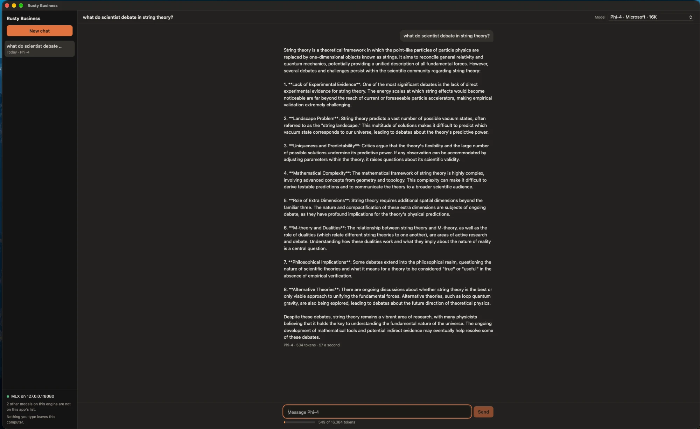

# Rusty Business

A desktop window for chatting with models that run on your own computer, and
the start of the servers that will sit behind it. Nothing you type leaves the
machine.



## What is here

This is one repository for the whole project. Every folder has a README that
says what is in it.

| Folder                               | What it holds                                                 | Today                                                         |
| ------------------------------------ | ------------------------------------------------------------- | ------------------------------------------------------------- |
| [apps/desktop](apps/desktop)         | The chat window: a Rust shell (Tauri 2) around a Vue 3 page   | Works                                                         |
| [services/api](services/api)         | The API (Rust, axum)                                          | Stub: says who it is, and whether Postgres and Redis answer   |
| [services/worker](services/worker)   | The worker (Rust)                                             | Stub: reads each job off the queue and does nothing with it   |
| [packages/shared](packages/shared)   | Code the two services share: settings and the job format      | Works                                                         |
| [infra](infra)                       | The Docker stack: Postgres, Redis, MinIO, Mailpit, and Caddy  | Works                                                         |
| [e2e](e2e)                           | End-to-end tests against the running stack                    | Works                                                         |
| [scripts](scripts)                   | Bootstrap, helpers, and the repository's own checks           | Works                                                         |
| [docs](docs)                         | Pictures the READMEs show                                     |                                                               |

The chat window does not use the stack yet. It talks only to the model engine
on this computer. The stack is the ground the next features stand on.

## Run the chat window (macOS)

You need Rust, Node 20 or later, and Xcode's command line tools.

Start the model engine in one terminal:

```bash
mlx_lm.server --port 8080
```

Start the app in another:

```bash
cd apps/desktop && npm install && npm run tauri dev
```

More in [apps/desktop](apps/desktop).

## Run the stack

You need Docker (with Compose), `make`, and `openssl`.

```bash
make bootstrap
```

That writes `infra/.env` with new random passwords, builds the two services,
starts everything, and waits until every part reports healthy. After the
first run, `make up` and `make down` start and stop it; the data stays.

Everything listens on this computer only (127.0.0.1):

| Address                 | What answers                                |
| ----------------------- | ------------------------------------------- |
| http://127.0.0.1:4700   | The front door (Caddy), which passes to the API |
| http://127.0.0.1:4701   | The API, direct                             |
| http://127.0.0.1:4726   | Mailpit: every email the stack sends        |
| http://127.0.0.1:4791   | MinIO's console (file storage)              |
| 127.0.0.1:4732          | Postgres                                    |
| 127.0.0.1:4779          | Redis                                       |
| 127.0.0.1:4790          | MinIO's S3 address                          |
| 127.0.0.1:4725          | Mailpit's SMTP port                         |

A port that is already taken on your computer can be changed in `infra/.env`.
More in [infra](infra).

## Tests

```bash
make test
```

runs everything that needs no running stack: format, lint, and unit tests for
the services, the repository's own checks, and the desktop app's tests.

With the stack up:

```bash
make test-live
```

```bash
make e2e
```

The first runs the API's tests against the real Postgres and Redis. The second
checks every part of the stack from outside: the front door, the API, the
database migration, a job travelling from the queue to the worker, file
storage, and mail.

`make` alone lists every command.
