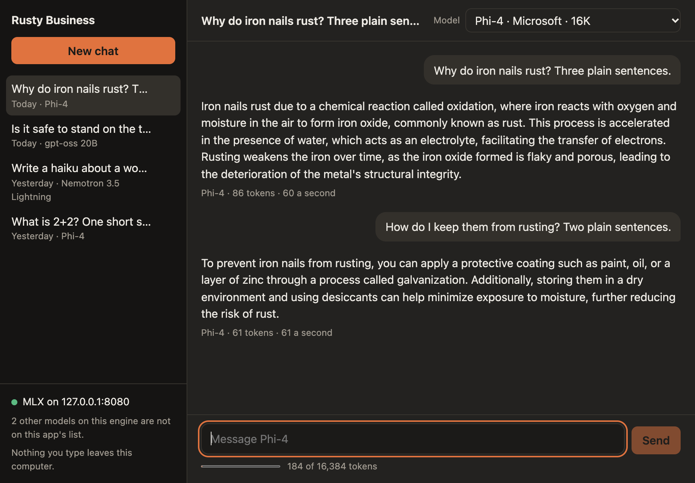

# The desktop app

A window for chatting with models that run on your own computer. The shell is
Rust (Tauri 2), the page is Vue 3, and nothing you type leaves the machine.

[](../../docs/screenshots/chat.png?raw=true)

Select the picture to open it full size. The rest of the set is in
[docs/screenshots](../../docs/screenshots).

## What it does

- **Chat** with a streamed reply, a Stop button, and the model's thinking kept
  apart from its answer.
- **Model picker** limited to a short list: Phi-4 (Microsoft), gpt-oss 20B
  (OpenAI), and Nemotron 3.5 Lightning (NVIDIA). A model the engine holds that
  is not on the list is never shown and never accepted.
- **Saved chats**, one JSON file each in the app's data folder. Trash moves a
  file into a `trash` folder; the app deletes nothing.
- **A context meter** that shows how full the model's window is.

## How it is put together

```
page (Vue)  --IPC-->  Rust  --http, this computer only-->  engine
```

The page never talks to the network. Rust owns two things:

- [src-tauri/src/engine.rs](src-tauri/src/engine.rs), the engine adapter. It
  speaks one contract, an OpenAI-style server (`GET /v1/models`,
  `POST /v1/chat/completions` with a streamed reply). It refuses any address
  that is not on this computer, filters the models, and separates thinking
  from the answer (channel markers, think tags, or a separate reasoning
  field).
- [src-tauri/src/sessions.rs](src-tauri/src/sessions.rs), the saved chats.

Which program serves the contract is the only thing that changes per system:

| System  | Engine                                             |
| ------- | -------------------------------------------------- |
| macOS   | `mlx_lm.server` (MLX, Apple silicon)               |
| Windows | not chosen yet; any server with the same two calls |

The engine's address defaults to `http://127.0.0.1:8080/v1`. Set
`RUSTY_ENGINE_URL` to use another port on this computer.

## What is in this folder

| Path                   | What it is                                              |
| ---------------------- | ------------------------------------------------------- |
| [src](src)             | The page: one Vue component and its helpers             |
| [src-tauri](src-tauri) | The Rust shell: the window, the engine adapter, saved chats |
| `index.html`           | The page's single HTML file                             |
| `vite.config.js`       | Vite's settings; the dev server stays on 127.0.0.1:1420 |
| `package.json`         | The page's packages and the `npm` commands below        |

## Run it (macOS)

You need Rust, Node 20 or later, and Xcode's command line tools.

Start the engine in one terminal:

```bash
mlx_lm.server --port 8080
```

Start the app in another, from this folder:

```bash
npm install
```

```bash
npm run tauri dev
```

## Tests

From the repository's root, `make test-desktop` runs all of these:

```bash
npm test
```

```bash
npm run build
```

```bash
cd src-tauri && cargo test
```

The page is built before the Rust tests because Tauri reads the built page
(`dist`) when it compiles.

One more test talks to the running engine and asks it for 2+2:

```bash
cd src-tauri && cargo test -- --ignored
```

## Where chats are kept

- macOS: `~/Library/Application Support/net.morrical.rusty-business/sessions`
- Windows: `%APPDATA%\net.morrical.rusty-business\sessions`
