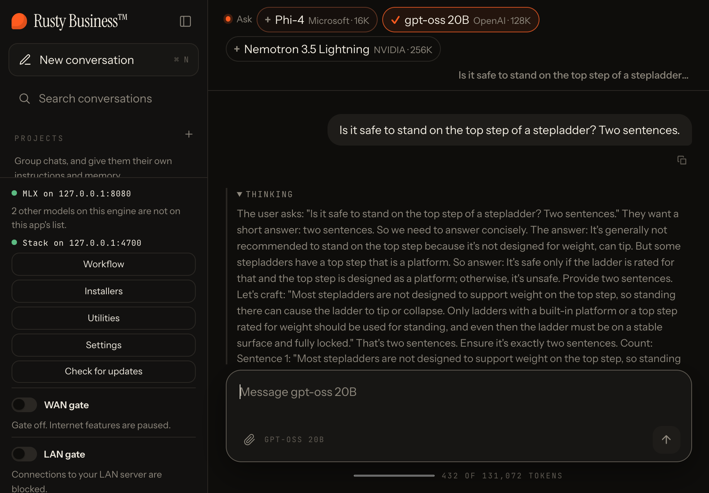
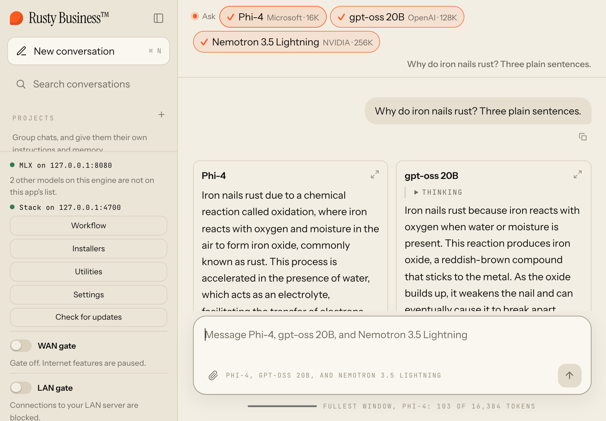
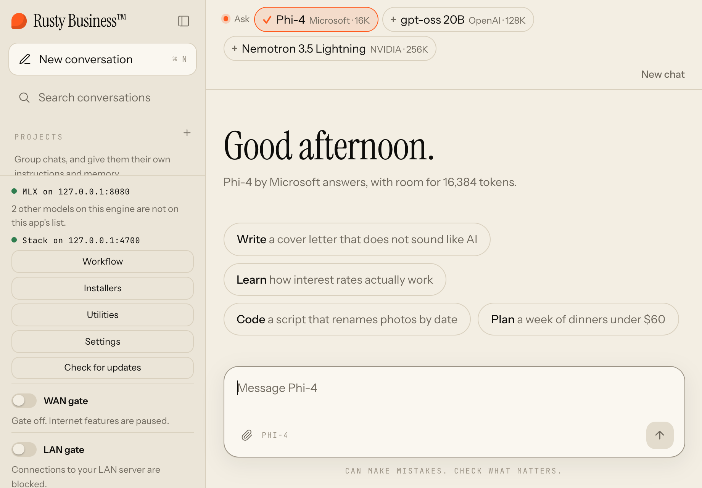
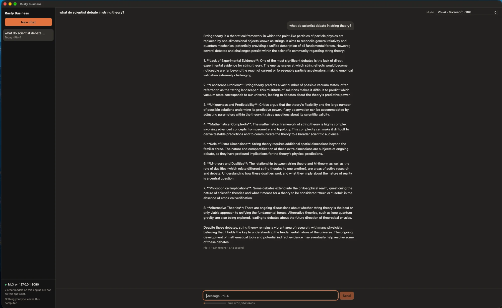

# Screenshots

Nine pictures of the chat window. Each is 1,840 pixels wide, taken from a
window 920 points wide, so the words are large enough to read. Select a
picture to open it full size.

## A chat

[](chat.png?raw=true)

Two questions to Phi-4 and its answers. Under each answer is the model's
name, how many tokens the answer took, and how fast they came. Saved chats
are on the left, the models are at the top with Phi-4 picked, and the meter
under the message box shows how full the model's window is.

## Thinking, apart from the answer

[](thinking.png?raw=true)

gpt-oss 20B thinks before it answers. The app keeps that thinking folded away
above the answer. Here it is opened.

## One question, three models

[](compare.png?raw=true)

Phi-4, gpt-oss 20B, and Nemotron 3.5 Lightning are picked, so each answers
the same question, and the answers sit side by side. The models on this
computer take turns, since the engine holds one at a time. gpt-oss and
Nemotron think first, and their thinking is folded away. The meter shows
the fullest of the three windows, and names its model.

## A new chat

[](new-chat.png?raw=true)

What the app shows before the first question. The app follows the system's
light or dark setting; this is light.

## No engine answering

[](engine-off.png?raw=true)

What the app shows when nothing answers at the engine's address and it could
not start an engine itself: which of its models are already on this computer,
why it did not start the engine, the command that starts one by hand, and a
button to try again.

## The first run

[](first-run.png?raw=true)

What the app shows when none of its models is on this computer. Microsoft
is ticked to begin with; ticking another maker adds its models below, each
with its maker, license, and download size, and the smallest marked as the
quickest to start. Microsoft cannot be unticked while it is the only maker
ticked. Nothing downloads until the outbound gate is on and Download is
pressed. More models, and the outside engines, are a click away on the
Installers page.

## The Installers page

[](installers.png?raw=true)

The Installers page, opened from the foot of the window above Settings,
groups the models by type in tabs: Chat, Pictures, Picture check, and
Outside engines. Its Chat tab lists every model on the app's list, from every
maker, with its license and download size, and marks the one that reads
pictures, so it shows on both the Chat and Pictures tabs. Install downloads one, once the outbound gate is on, then
adds its maker so the model shows at the top of the window. Here the gate is
off, so Install waits. A model already on this computer whose maker is not
added has a Show button instead. Grok, GPT, Claude, and Gemini are added on the
Outside engines tab, each on its own card.

## Models that read pictures

[](pictures.png?raw=true)

The Pictures tab lists the models that read a picture attached or pasted in
the chat. Phi-3.5 Vision installs in one click, once the outbound gate is on,
and runs on this computer through mlx-vlm. Phi-4-multimodal and Molmo-7B-O
are listed as coming in a later build, with nothing to download yet. For now
these models need a Mac, and a picture never goes to an outside engine.

## Settings: the models, and their makers

[](settings.png?raw=true)

Settings, opened from the foot of the window, lists under Models every maker
on the app's list with its models. Add and Remove pick a maker with one click. Here the
makers picked are the three whose models are on this computer, as the app
picks them before you do. Removing one hides its models and deletes nothing,
and saved chats still name them. Each model on this computer has a switch:
switched off, it is left out of questions, grading, and comparisons, and its
files stay. Uninstall asks first, then moves the model to the Trash. To
download a model, Settings points to the Installers page.

## How these were made

```bash
make screenshots
```

builds the app's page and runs
[scripts/screenshots.mjs](../../scripts/screenshots.mjs), which opens the page
in Google Chrome with no window on screen and saves each picture here.

These are pictures of the app's page, not captures of the app's window:

- There is no title bar, and the first run's boxes are drawn by Chrome. The
  app uses the system's web view, which draws them its own way.
- Rust is not running. The page's calls to it are answered from
  [chats.json](chats.json): what the app reported about the engine on one
  Mac with every maker picked, the five models it offers with their sizes,
  and replies the three models there gave, recorded once. One of the chats
  puts the same question to all three. Each picture picks
  makers as the app does before you pick any: Microsoft, and the maker of
  each model already on the computer. The words, token counts, and speeds
  are real. Nothing is sent to a model while the pictures are made, and no
  engine is started: in the pictures of no engine and of the first run, the
  page is told why the app did not start one. For the first run, it is also
  told that none of the models is on this computer, and nothing downloads.
  No stack is started either: in every picture, the page is told the stack's
  front door already answers. Grok, GPT, Claude, and Gemini are not added, and no
  key is read. The outbound gate is off in every picture, as it is until it is
  turned on, and no maker can be changed.
- "Today" and "Yesterday" are counted from the day the pictures are made.
- Made on another system, the letters come out in that system's font.

## The first picture

[](../chat-window.webp?raw=true)

The one capture of the app's real window, title bar and all. The window was
wide when it was taken, so its words are small. It is kept here and shown
nowhere else.

## What is in this folder

| File             | What it is                                                     |
| ---------------- | -------------------------------------------------------------- |
| `chat.png`       | A chat with two questions answered                             |
| `thinking.png`   | A chat with the model's thinking opened                        |
| `compare.png`    | One question answered by three models, side by side            |
| `new-chat.png`   | A new chat, before the first question                          |
| `engine-off.png` | The app with no engine answering                               |
| `first-run.png`  | The first run, with none of the app's models on this computer  |
| `installers.png` | The Installers page, with every maker's models                 |
| `pictures.png`   | The Installers page's Pictures tab, with the models that read pictures |
| `settings.png`   | Settings, Models, with a switch and Uninstall for each model   |
| `chats.json`     | What the pictures are made from: the engine's report, the models offered, and five recorded chats |
