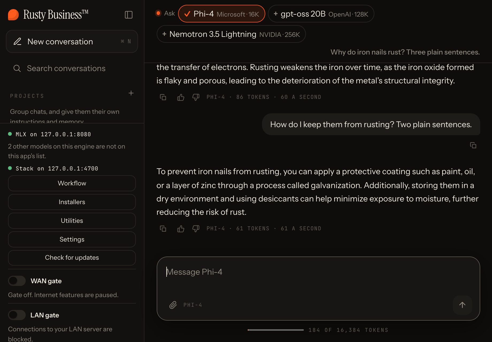
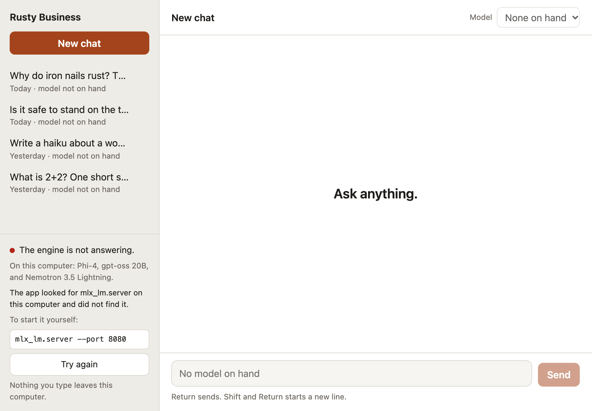

# Screenshots

Four pictures of the chat window. Each is 1,840 pixels wide, taken from a
window 920 points wide, so the words are large enough to read. Select a
picture to open it full size.

## A chat

[](chat.png?raw=true)

Two questions to Phi-4 and its answers. Under each answer is the model's
name, how many tokens the answer took, and how fast they came. Saved chats
are on the left, the model picker is at the top right, and the meter under
the message box shows how full the model's window is.

## Thinking, apart from the answer

[](thinking.png?raw=true)

gpt-oss 20B thinks before it answers. The app keeps that thinking folded away
above the answer. Here it is opened.

## A new chat

[](new-chat.png?raw=true)

What the app shows before the first question. The app follows the system's
light or dark setting; this is light.

## No engine answering

[](engine-off.png?raw=true)

What the app shows when nothing answers at the engine's address and it could
not start an engine itself: which of its models are already on this computer,
why it did not start the engine, the command that starts one by hand, and a
button to try again.

## How these were made

```bash
make screenshots
```

builds the app's page and runs
[scripts/screenshots.mjs](../../scripts/screenshots.mjs), which opens the page
in Google Chrome with no window on screen and saves each picture here.

These are pictures of the app's page, not captures of the app's window:

- There is no title bar, and the model picker is drawn by Chrome. The app
  uses the system's web view, which draws that control its own way.
- Rust is not running. The page's calls to it are answered from
  [chats.json](chats.json): what the app reported about the engine on one
  Mac, and replies the three models gave there, recorded once. The words,
  token counts, and speeds are real. Nothing is sent to a model while the
  pictures are made, and no engine is started: in the last picture, the page
  is told what the app says when it does not find the engine's program.
- "Today" and "Yesterday" are counted from the day the pictures are made.
- Made on another system, the letters come out in that system's font.

## The first picture

[](../chat-window.webp?raw=true)

The one capture of the app's real window, title bar and all. The window was
wide when it was taken, so its words are small. It is kept here and shown
nowhere else.

## What is in this folder

| File             | What it is                                                     |
| ---------------- | -------------------------------------------------------------- |
| `chat.png`       | A chat with two questions answered                             |
| `thinking.png`   | A chat with the model's thinking opened                        |
| `new-chat.png`   | A new chat, before the first question                          |
| `engine-off.png` | The app with no engine answering                               |
| `chats.json`     | What the pictures are made from: the engine's report and four recorded chats |
